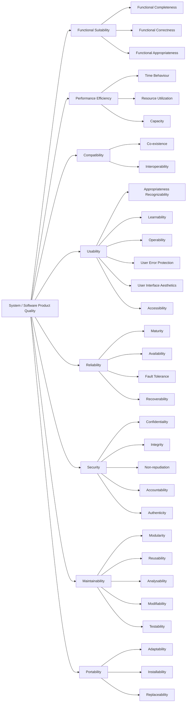

[](https://github.com/seahal/umaxica-apps-cosmos-press/actions/workflows/ci.yml)


# Umaxica Apps Cosmos Press

## Routing

This repository serves only its own Press surfaces:

- `edit` (`org`): staff publishing management and the independent Edit browser relying party
- `info`, `docs`, `news`, and `help`: public content surfaces for `app`, `com`, and `org`
- the repository's operator tools: Mission, Flipper, Blazer, PgHero, Swagger, and Coverband

Routes for the owned Press surfaces and operator tools are host-constrained. One unconstrained
fallback route handles unknown hosts. Auth, Base, Core, Palm, Tech, Visa, and Warp are not hosted by
this repository. Edit still uses Access Auth/Visa for its external OIDC flow and retains the Base
domain values required by its existing preference and mail-link contracts; those integrations do not
make those surfaces local Press routes.

## Stack

### Backend

- Ruby on Rails (`8.2.x`, pre-release)
- Podman services for local infrastructure
- Storage: PostgreSQL (with Solid Queue), Valkey/Redis

### Frontend

- Rails ERB views with one Tailwind CSS entrypoint per owned surface, built through Vite Rails
- Propshaft serves static non-browser assets
- Bun runs Vite CSS builds, formatting, linting, type checking and OpenAPI validation

### Infrastructure

- Dev: FakeCloud
- Test: N/A
- Prod: N/A
- CI: GitHub Actions
- CD: N/A

## Frontend and Assets

UI implementation should treat the Digital Agency of Japan Design System introduction as reading
before inventing screen patterns. Start at
[the introduction](https://design.digital.go.jp/dads/introduction/) and
`docs/reference/digital-agency-design-system.md`. Current Rails markup and shared CSS tokens are
documented in `docs/design.md`.

- Browser CSS is one Vite stylesheet per surface under `src/styles/surfaces/`; each imports the
  shared token and base layers (`src/styles/theme.css`, `src/styles/base.css`).
- Static non-browser assets are served by Propshaft.

Useful commands:

```bash
bin/dev                         # Web, Vite, and jobs
bin/rails assets:precompile     # Production asset build
bin/rails vite:build            # Vite frontend build
bin/rails assets:clobber        # Remove compiled assets
```

## Local Setup

- Docker Compose, or rootless Podman with `podman-compose`
- Ruby `4.0.x`
- Bundler
- Node.js `26.13.1` (pinned in `.node-version`; `package.json` accepts `>=26.13.1 <27`)
- Bun `1.4.0`

### Host setup

Install the Ruby, Node.js and Bun versions pinned by mise. The tracked `.envrc` supplies local
defaults. Review and authorize it in your shell. Provision both Rails credential keys through the
development lead and keep local settings in the ignored `.envrc.credential` or `.envrc.local`.

```bash
mise install
direnv allow
test -d tmp/pg || install -d -m 0777 tmp/pg
podman compose up -d
```

Compose starts PostgreSQL, Valkey and FakeCloud. Rails and Vite run on the host. Development uses
PostgreSQL on loopback ports 25432 and 25433. Rails tests connect through the primary's socket in
`tmp/pg`. The Cloudflare connectors use the opt-in `tunnel` and `workers-vpc` profiles.

For new volumes, initialize the development and test databases from migrations before setup.
Structure dumps omit reference rows inserted by migrations. See the
[DB workflow](docs/operations/db-workflow.md). Stop Compose with `podman compose down -t 120` to
allow PostgreSQL to shut down cleanly.

WebAuthn uses one RP ID and one exact origin per surface (`app` and `org`). Production requires them
as environment variables; other environments read the same variables first and fall back to the
encrypted credentials `webauthn.<surface>.rp_id` / `origin`. A missing value raises. The RP ID must
equal the origin host (`app/values/webauthn/relying_party_config.rb`).

```bash
WEBAUTHN_APP_RP_ID  WEBAUTHN_APP_ORIGIN
WEBAUTHN_ORG_RP_ID  WEBAUTHN_ORG_ORIGIN
```

`bin/setup` installs Ruby gems, runs `bun install --frozen-lockfile` and `bin/rails db:prepare`,
clears logs and temp files, then starts `bin/dev` (pass `--skip-server` to stop before that).

If dependencies are already installed, you can start development directly:

```bash
bin/dev
```

`bin/dev` is the unified local entrypoint. It runs `bin/rails db:prepare` unless
`SKIP_DB_PREPARE=1`, then starts:

- `web`: Rails server on loopback port `3030`
- `vite`: `bin/vite dev`
- `jobs`: `bin/jobs start`

## Development URLs

Modern browsers resolve `*.localhost` to `127.0.0.1`, so extra `/etc/hosts` entries are usually not
needed.

Rails and Vite listen on loopback ports 3030 and 3036 as configured in `.envrc`.

| Surface        | URL                                                                           |
| :------------- | :---------------------------------------------------------------------------- |
| Edit           | `https://edit.umaxica.org` and `http://edit.org.localhost:3030`               |
| Info           | `http://info.{app,com,org}.localhost:3030`                                    |
| Docs           | `http://docs.{app,com,org}.localhost:3030`                                    |
| News           | `http://news.{app,com,org}.localhost:3030`                                    |
| Help           | `http://help.{app,com,org}.localhost:3030`                                    |
| Operator tools | `https://{mission,flipper,blazer,pghero,swagger,coverband}-press.umaxica.dev` |

Operator tools also retain their route-local development aliases under `*.core.dev.localhost`.
Configured private and public origins remain in the environment files; this table lists the stable
local and canonical hosts without copying environment values.

The application contract supplies PUBLIC and PRIVATE URL values in both supported modes; Compose
supplies only service topology. Each route host constraint lists the configured host alongside its
localhost literal. Development is published through Cloudflare Tunnel behind Cloudflare Access;
Access, not Host Authorization, keeps the development listener non-public. See
`docs/architecture/cloudflare-request-paths.md` for the trust boundaries and
`research/implementation/2026-08-10-development-tunnel-access-verification.md` for the measured
end-to-end evidence.

## Code Quality

This project organizes code quality around the ISO/IEC 25010 System / Software Product Quality
model. The `Linting and Formatting` / `Testing` / `Security and Quality Checks` sections below each
correspond to concrete, operational means of supporting these quality characteristics.



## Linting and Formatting

```bash
bundle exec rubocop
bundle exec rubocop -a
bundle exec erb_lint .
bundle exec erb_lint -a .
bun run check
bun run fix
```

Use `rubocop -a`, `erb_lint -a .`, and `bun run fix` to apply auto-fixes where available.

## Testing

### Rails Tests

```bash
bundle exec rails test
COVERAGE=true bundle exec rails test test/
```

Rails generates a Valkey test-run namespace when one is not supplied. Coverage reports are written
to `coverage/`. Set `PARALLEL_WORKERS=1` for a focused run when diagnosing a failure.

## Security and Quality Checks

```bash
bundle exec brakeman --no-pager
bundle exec bundler-audit check --update
bun audit
bundle exec debride
```

`debride` is configured for Rails-aware analysis and can also be scoped to specific paths:

```bash
bundle exec debride app/services
DEBRIDE_MINIMUM=5 bundle exec debride
```

## Logging

Application logging is structured. Prefer event-style logging over ad hoc `Rails.logger` calls when
adding domain events or operational signals.

```ruby
Rails.event.notify("user.created", user_id: user.id)
Rails.event.tagged("auth") { Rails.event.notify("login.success", user_id: user.id) }
```

## Pre-commit Checks

Run the Lefthook pre-commit checks before committing:

```bash
lefthook run pre-commit
```

The pre-commit hook formats staged files with oxfmt, autocorrects them with oxlint and RuboCop, and
compiles every ERB template when a view changed. The pre-push hook runs `bun run ci` (CSS and
OpenAPI checks plus the production asset build). Security audits and the full Rails suite run in CI,
not in the hooks.

## Troubleshooting

| Problem                                  | Fix                                                                                                 |
| :--------------------------------------- | :-------------------------------------------------------------------------------------------------- |
| Tailwind changes are not reflected       | Run `bin/rails assets:clobber` and restart `bin/dev`                                                |
| Tests fail because databases are missing | Run `bin/rails db:prepare`                                                                          |
| `bin/dev` stops during boot              | Check the required `PUBLIC_AUTH_SERVICE_URL` and `PUBLIC_AUTH_STAFF_URL` plus database availability |
| Credentials cannot be decrypted          | Obtain the key; see `docs/operations/development-credential-provisioning.md`                        |

## Repository Knowledge Base

See [repository knowledge architecture](docs/reference/repository-knowledge-architecture.md) for
ownership, authority and lifecycle.

- [Specs](specs/README.md): accepted change contracts.
- [ADRs](adr/repository-knowledge-and-agent-harness.md): accepted decisions and their rationale.
- [Docs](docs/index.md): current engineering documentation and durable acceptance checklists.
- [Research](research/README.md): non-authoritative institutional memory and rejected approaches.
- [Plans](plans/README.md): unaccepted proposals and useful planning history.
- `evidence/`: actual observations against a stated revision, not expectations.
- [Manuals](manuals/README.md): user guidance; presence does not mean published.
- `test/`: Rails Minitest checks.

## Acknowledgement

- Secrets must stay in Rails credentials; do not commit plaintext secrets.
- WebAuthn origins are derived from `PUBLIC_AUTH_SERVICE_URL` and `PUBLIC_AUTH_STAFF_URL`;
  `TRUSTED_ORIGINS` is additive only.
- Public availability of this repository is not guaranteed permanently.
